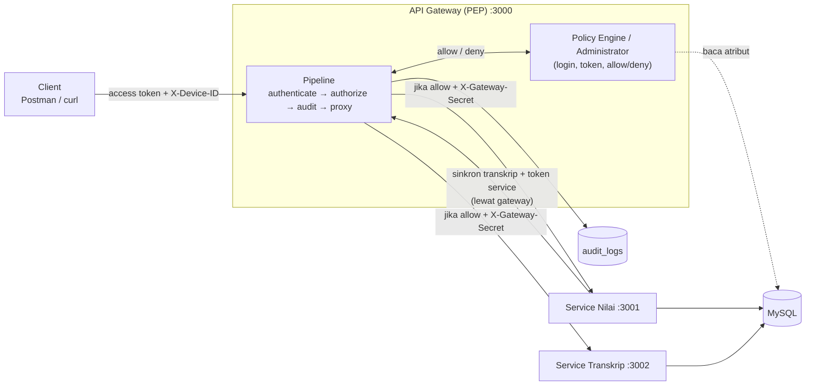
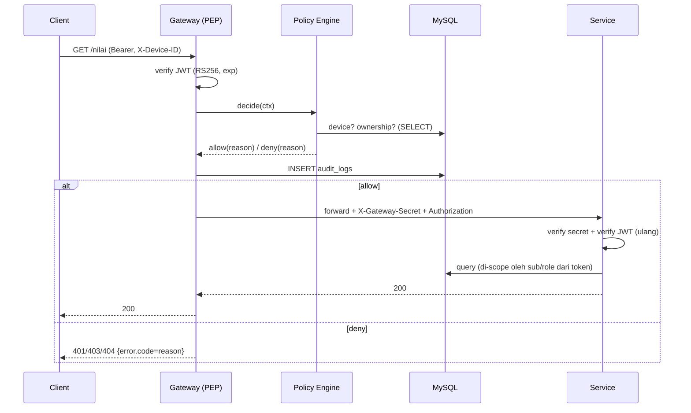

# ARCHITECTURE — Sistem Nilai Zero Trust

Mengikuti Gambar 1 pada tugas dan NIST SP 800-207. Dokumen ini normatif: implementasi harus sesuai.

## 1. Prinsip → mekanisme

| Prinsip | Mekanisme |
|---|---|
| Never trust, always verify | Setiap request diverifikasi gateway; service **verifikasi ulang** secret + token; panggilan antar-service juga lewat gateway |
| Least privilege | Rule per endpoint + default deny; user DB per komponen dengan grant minimum |
| Assume breach | RS256 (service tidak bisa mencetak token); cek kepemilikan atomik di SQL; token pendek; refresh token dapat dicabut |

## 2. Diagram komponen



**Versi file Mermaid** (`docs/diagrams/*.mmd`, bisa dibuka di mermaid.live / preview VS Code / `mmdc`): `architecture.mmd` (komponen & aliran data penuh, termasuk `GET /audit` dan volume kunci) · `flow-login.mmd` (login + rotasi refresh) · `flow-request-policy.mmd` (pipeline keputusan PE pada request terkendali) · `flow-finalization-sync.mmd` (finalisasi, token service, retry `sync_status`) · `flow-audit-trail.mmd` (`GET /audit` admin only + self-audit).

## 3. Komponen

| Komponen | Port | Peran NIST | Tanggung jawab | User DB |
|---|---|---|---|---|
| API Gateway | 3000 (publik) | PEP | Satu-satunya pintu; authenticate, minta keputusan ke PE, audit, proxy + secret | `zt_gateway` |
| Policy Engine/Administrator | di dalam gateway | PE / PA | Login, terbit/cabut token, keputusan allow/deny dari Tabel 3 + atribut DB | (sama) |
| Service Nilai | 3001 (internal) | Resource | Data nilai & kelas; finalisasi; memanggil sinkron transkrip via gateway | `zt_nilai` |
| Service Transkrip | 3002 (internal) | Resource | Data transkrip; menerima sinkron hanya dari token service | `zt_transkrip` |
| MySQL 8.4 | 3306 | Resource | Satu database bersama | root (hanya init) |
| Audit Log | tabel `audit_logs` | Data source | Ditulis gateway | `zt_gateway` (INSERT saja) |

## 4. Pipeline request di gateway

Untuk rute yang di-proxy (`/nilai/*`, `/kelas/*`, `/transkrip/*`):

1. **requestId** — buat/terima `X-Request-ID` (UUID), pasang ke log & audit.
2. **authenticate** — ambil `Authorization: Bearer`; verifikasi tanda tangan RS256, `exp`, `iss`, `typ`. Gagal → deny `TOKEN_MISSING|TOKEN_INVALID|TOKEN_EXPIRED` (401). Hasil: `req.auth = {subject}`.
3. **authorize(ruleKey)** — bentuk `PolicyContext`, panggil `PolicyEngine.decide()`. Deny → `AccessDeniedError`.
4. **audit** — allow ditulis oleh `authorize`; deny ditulis oleh error handler global (satu request = satu baris).
5. **proxy** — hapus `X-Gateway-Secret` dari klien, set secret asli, teruskan ke service.
6. **Rute tak terdaftar** → `ROUTE_NOT_REGISTERED` (default deny).

`/auth/*` ditangani gateway sendiri (controller → service → repository), tidak lewat PE, tetap diaudit. Pengecualian publik yang terdokumentasi: `GET /health`, `GET /docs`, `GET /openapi.json` (dimatikan dengan `SWAGGER_ENABLED=false`).



## 5. Policy Engine

```ts
type Subject =
  | { type: 'user'; id: number; role: 'mahasiswa' | 'dosen' | 'admin' }
  | { type: 'service'; id: string; role: 'service' };

interface PolicyContext {
  subject: Subject; deviceId?: string;
  method: string; path: string;
  params: Record<string,string>; query: Record<string,string>;
  now: Date; requestId: string;
}
type Decision = { effect: 'allow' | 'deny'; reason: ReasonCode; status: number };

interface PolicyRule {
  key: string;                 // mis. 'nilai.update'
  allowedRoles: Array<Subject['role']>;
  requiresAccessHours: boolean;
  evaluate(ctx: PolicyContext): Promise<Decision>;   // atribut/kepemilikan/status via PolicyRepository
}
```

**Urutan evaluasi** (berhenti di deny pertama): ① subjek user aktif & **device terdaftar** (user saja; token service dilewati) → ② **role** ∈ `allowedRoles` → ③ **jam akses** bila `requiresAccessHours` → ④ `rule.evaluate` (atribut dari DB).

**Aturan (Tabel 3):**

| Rule key | Endpoint | Role | Jam | Evaluasi atribut |
|---|---|---|---|---|
| `nilai.list` | `GET /nilai` | mahasiswa, dosen | – | mahasiswa: `query.nim` kosong atau = `users.nim` milik `sub`. dosen: bila `query.kelas_id` ada → `kelas.dosen_id = sub` |
| `nilai.update` | `PUT /nilai/:id` | dosen | ✔ | nilai ada (404) → `kelas.dosen_id = sub` → `nilai.status = DRAFT` |
| `kelas.finalize` | `POST /kelas/:id/finalisasi` | dosen | ✔ | kelas ada (404) → `kelas.dosen_id = sub` |
| `transkrip.get` | `GET /transkrip/:nim` | mahasiswa, admin | – | mahasiswa: `:nim = users.nim` milik `sub`; admin: semua |
| `transkrip.sync` | `POST /transkrip/sinkron` | service | – | `subject.id = 'service-nilai'`; token user mana pun ditolak |
| `audit.list` | `GET /audit` | admin | – | tanpa atribut — role admin saja (deny lainnya otomatis dari cek role/scope); dibaca gateway langsung dari `audit_logs`, tidak ke service |

**Reason code** (dipakai di keputusan, audit, dan respons `error.code`):

| Allow | Deny |
|---|---|
| `OWN_DATA`, `CLASS_OWNER`, `ADMIN_ALL`, `SERVICE_TOKEN`, `LOGIN_OK`, `REFRESH_OK`, `LOGOUT_OK`, `SERVICE_TOKEN_ISSUED`, `ADMIN_AUDIT_READ` | `TOKEN_MISSING`, `TOKEN_INVALID`, `TOKEN_EXPIRED`, `DEVICE_HEADER_MISSING`, `DEVICE_NOT_REGISTERED`, `USER_INACTIVE`, `ROLE_NOT_ALLOWED`, `USER_TOKEN_ON_SERVICE_ENDPOINT`, `SERVICE_TOKEN_ON_USER_ENDPOINT`, `SERVICE_NOT_ALLOWED`, `OUTSIDE_ACCESS_HOURS`, `NOT_OWN_DATA`, `NOT_CLASS_OWNER`, `GRADE_ALREADY_FINAL`, `RESOURCE_NOT_FOUND`, `ROUTE_NOT_REGISTERED`, `INVALID_CREDENTIALS`, `CLIENT_INVALID`, `REFRESH_INVALID`, `REFRESH_EXPIRED`, `REFRESH_REVOKED` |

Kode tambahan yang hanya dihasilkan **service** (bukan PE): `GATEWAY_SECRET_INVALID` (403; header `X-Gateway-Secret` hilang/salah). Service juga memakai `TOKEN_MISSING|TOKEN_INVALID|TOKEN_EXPIRED` (401) dan `ROLE_NOT_ALLOWED` (403) untuk verifikasi ulang. Service tidak menulis audit log (hak DB-nya tidak mencakup `audit_logs`); keputusan dari gateway-lah yang diaudit.

## 6. Token

| Token | Format | Masa | Isi | Disimpan |
|---|---|---|---|---|
| Access | JWT RS256 | 10 menit | `sub` (user id), `role`, `typ:"access"`, `iss:"zt-gateway"`, `iat`, `exp`, `jti` | klien |
| Refresh | string acak 256-bit (base64url) | 1 hari | – (opaque) | DB: hash SHA-256, `device_id`, `expires_at`, `revoked_at` |
| Service | JWT RS256 | 5 menit | `sub:"service-nilai"`, `role:"service"`, `typ:"service"`, `iss`, `iat`, `exp`, `jti` | memori Service Nilai |

- Verifikasi **wajib** `algorithms: ['RS256']` (tolak `none`/HS*) dan cek `iss` + `typ`.
- Refresh: **rotasi** (token lama dicabut, baru diterbitkan) dan terikat `X-Device-ID` yang sama dengan saat login.
- Atribut kepemilikan **tidak** ada di token; PE membacanya dari DB.

## 7. Alur utama

**Login:** `POST /auth/login` + `X-Device-ID` → cari user → bcrypt compare → cek device aktif milik user → terbitkan access + refresh → audit `LOGIN_OK` / deny.

**Finalisasi + sinkron transkrip:**

```mermaid
sequenceDiagram
  participant D as Dosen
  participant G as Gateway
  participant N as Service Nilai
  participant T as Service Transkrip
  D->>G: POST /kelas/1/finalisasi
  G->>G: authenticate + PE (dosen, pemilik, jam akses)
  G->>N: forward (+secret)
  N->>N: TX: kelas valid? semua nilai terisi? set nilai FINAL, sync_status=PENDING
  N->>G: POST /auth/service (client id + secret)  [cache token 5 menit]
  G-->>N: token service
  N->>G: POST /transkrip/sinkron (Bearer token service)
  G->>G: PE: hanya role service
  G->>T: forward (+secret)
  T->>T: verify secret + token; upsert idempoten
  T-->>N: 200
  N->>N: sync_status=SYNCED
  N-->>D: 200 {sync_status:"SYNCED"}
```

Bila sinkron gagal: `sync_status=FAILED`, respons **502 `SYNC_FAILED`**; memanggil finalisasi lagi hanya mengulang sinkron (idempoten). Finalisasi ulang saat `SYNCED` → 409 `ALREADY_FINALIZED`. Nilai kosong → 422 `GRADES_INCOMPLETE`.

**Defense in depth di service:** Service Nilai menyaring data dari token terverifikasi (mahasiswa: `mahasiswa_id = sub`; dosen: `kelas.dosen_id = sub`) dan `UPDATE`/finalisasi memakai guard atomik (D11). Service Transkrip mengecek role kasar per endpoint (sinkron = `service`; baca = `mahasiswa|admin`); kepemilikan NIM diputuskan PE (batas yang diterima; lihat `SECURITY.md`).

## 8. Layering & aturan dependensi

```
routes → controller → service → repository → database
              ↘ validator (zod)        ↘ (SQL parameterized saja)
```

| Layer | Boleh | Dilarang |
|---|---|---|
| routes | mendaftar path + middleware + controller | logika bisnis |
| controller | baca `req`, panggil service, tulis `res` | SQL, aturan bisnis |
| service | aturan bisnis, transaksi, orkestrasi repository/klien | menyentuh `req/res`, SQL mentah |
| repository | SQL terparameter, memetakan baris → objek | aturan bisnis, `req/res` |
| middleware (`common/`) | urusan lintas (auth, validasi, error) | SQL domain |
| policy rule | keputusan allow/deny | mengubah data |

Error: service melempar `AppError` turunan; hanya error handler global yang membentuk respons.

## 9. Struktur folder

```
zero-trust-nilai/
├─ README.md  PLAN.md  AGENTS.md  docker-compose.yml  .env.example
├─ docs/            ARCHITECTURE.md DATABASE.md API.md SECURITY.md TESTING.md DEMO.md
├─ db/init/         01-schema.sql 02-seed.sql 03-grants.sh
├─ scripts/         demo.sh
├─ postman/         collection.json
├─ gateway/
│  ├─ Dockerfile  package.json  tsconfig.json
│  ├─ src/
│  │  ├─ server.ts  app.ts
│  │  ├─ config/        env.ts
│  │  ├─ database/      pool.ts
│  │  ├─ common/
│  │  │  ├─ errors/     app-error.ts access-denied.error.ts reason-codes.ts
│  │  │  ├─ middlewares/ request-id.ts error-handler.ts validate.ts
│  │  │  └─ utils/      logger.ts async-handler.ts clock.ts
│  │  ├─ middlewares/   authenticate.ts authorize.ts
│  │  └─ modules/
│  │     ├─ auth/       auth.routes.ts auth.controller.ts auth.service.ts token.service.ts auth.schema.ts
│  │     │              user.repository.ts device.repository.ts refresh-token.repository.ts service-client.repository.ts
│  │     ├─ policy/     policy.engine.ts policy.types.ts policy.repository.ts
│  │     │  └─ rules/   device.rule.ts access-hours.rule.ts nilai.rules.ts kelas.rules.ts transkrip.rules.ts audit.rules.ts index.ts
│  │     ├─ audit/      audit.service.ts audit.repository.ts audit.types.ts audit.schema.ts audit.controller.ts audit.routes.ts
│  │     ├─ proxy/      proxy.routes.ts proxy.factory.ts
│  │     └─ docs/       docs.routes.ts openapi/*.yaml
│  └─ tests/            unit/ integration/
├─ service-nilai/
│  └─ src/
│     ├─ server.ts app.ts  config/  database/
│     ├─ common/        errors/ middlewares/(verify-gateway-secret verify-token require-role error-handler) utils/
│     ├─ integrations/  gateway.client.ts service-token.provider.ts transkrip-sync.client.ts
│     └─ modules/
│        ├─ nilai/      nilai.routes.ts nilai.controller.ts nilai.service.ts nilai.repository.ts nilai.schema.ts grading.ts
│        └─ kelas/      kelas.routes.ts kelas.controller.ts kelas.service.ts kelas.repository.ts
└─ service-transkrip/
   └─ src/ …(sama) modules/transkrip/ transkrip.routes.ts transkrip.controller.ts transkrip.service.ts transkrip.repository.ts transkrip.schema.ts
```

## 10. Docker

- `docker-compose.yml` di root; service: `keygen` (one-shot), `mysql`, `gateway`, `service-nilai`, `service-transkrip`.
- Volume: `mysql_data`; `jwt_private` (hanya gateway), `jwt_public` (gateway + service).
- Port host: `3000` (gateway); `127.0.0.1:3001/3002` hanya demo; `127.0.0.1:3307` MySQL opsional.
- Healthcheck: MySQL via TCP; service memakai `/internal/health` **dengan** `X-Gateway-Secret` (tanpa pengecualian).
- Dockerfile (tiap app): stage `build` (`npm ci`, `tsc`) → stage `runtime` (`node:22-alpine`, `npm ci --omit=dev`, `USER node`, `CMD node dist/server.js`).
- Swagger UI hanya di gateway: `http://localhost:3000/docs`.

## 11. Konfigurasi (env)

| Var | Gateway | Nilai | Transkrip | Keterangan |
|---|:-:|:-:|:-:|---|
| `PORT` | 3000 | 3001 | 3002 | |
| `DB_HOST/PORT/NAME/USER/PASSWORD` | ✔ | ✔ | ✔ | user berbeda tiap komponen |
| `JWT_PRIVATE_KEY_PATH` | ✔ | – | – | |
| `JWT_PUBLIC_KEY_PATH`, `JWT_ISSUER` | ✔ | ✔ | ✔ | |
| `ACCESS_TOKEN_TTL_SECONDS` / `REFRESH_…` / `SERVICE_…` | 600 / 86400 / 300 | – | – | |
| `GATEWAY_SECRET` | ✔ | ✔ | ✔ | ≥ 32 karakter |
| `SERVICE_NILAI_URL`, `SERVICE_TRANSKRIP_URL` | ✔ | – | – | |
| `GATEWAY_URL`, `SERVICE_CLIENT_ID/SECRET` | – | ✔ | – | |
| `ACCESS_HOURS_START/END/TZ` | ✔ | – | – | default 07:00 / 21:00 / Asia/Jakarta |
| `SWAGGER_ENABLED`, `LOG_LEVEL` | ✔ | – | – | |

Semua env divalidasi zod saat start; aplikasi berhenti bila tidak valid.

## 12. Error & status HTTP

Bentuk: `{ "error": { "code": "NOT_CLASS_OWNER", "message": "…", "requestId": "…" } }`.

| Status | Pemakaian |
|---|---|
| 400 | validasi input gagal (`VALIDATION_ERROR`) |
| 401 | token tidak ada/invalid/kedaluwarsa; kredensial login/refresh/client salah |
| 403 | deny kebijakan (role, device, jam, kepemilikan, status final) |
| 404 | resource tidak ada (`RESOURCE_NOT_FOUND`) |
| 409 | `ALREADY_FINALIZED` |
| 422 | `GRADES_INCOMPLETE` |
| 502 | `SYNC_FAILED` (Transkrip tidak dapat dihubungi/menolak) |
| 500 | tak terduga (detail hanya di log) |
