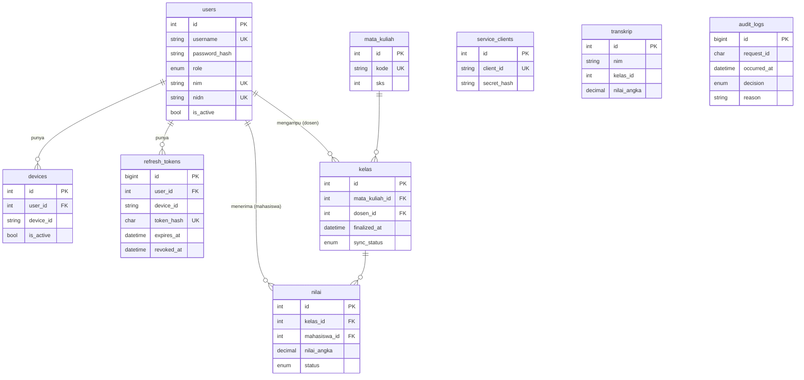

# DATABASE — MySQL 8.4 (Docker)

Sumber kebenaran skema: `db/init/01-schema.sql`. Dokumen ini menjelaskan, bukan menggantikan. Bila skema berubah, ubah SQL **dan** dokumen ini.
File di `db/init/` dijalankan otomatis (urut abjad) hanya saat volume `mysql_data` masih kosong. Terapkan ulang: `docker compose down -v && docker compose up -d --build`.

> Status verifikasi: skema, seed, dan grants sudah dijalankan di **MariaDB** (lolos). Belum dicoba di MySQL 8.4 — dicek di Fase 1 PLAN.md.

## 1. ER diagram

`transkrip` dan `audit_logs` sengaja **tanpa FK**: `transkrip` adalah snapshot milik Service Transkrip (batas antar-service), `audit_logs` harus utuh walau user dihapus.

## 2. Tabel

| Tabel | Pemilik | Fungsi | Catatan penting |
|---|---|---|---|
| `users` | Gateway (PE/PA) | Identitas & role | `nim` wajib untuk mahasiswa, null untuk lainnya (CHECK). `password_hash` = bcrypt. JWT `sub` = `users.id` |
| `devices` | Gateway | Device terdaftar per user | `UNIQUE(user_id, device_id)`; `is_active` |
| `refresh_tokens` | Gateway | Refresh token yang dapat dicabut | Simpan **hash** SHA-256; `revoked_at` terisi saat logout/rotasi |
| `service_clients` | Gateway | Kredensial service (client ID + secret) | `secret_hash` bcrypt; seed: `service-nilai` |
| `mata_kuliah` | Nilai | Master mata kuliah | `sks` dipakai transkrip/IPK |
| `kelas` | Nilai | Kelas yang diampu dosen | `finalized_at`, `sync_status` (NONE→PENDING→SYNCED/FAILED) |
| `nilai` | Nilai | Nilai per mahasiswa per kelas | `status` DRAFT/FINAL; `UNIQUE(kelas_id, mahasiswa_id)`; `CHECK 0–100` |
| `transkrip` | Transkrip | Snapshot nilai final | `UNIQUE(nim, kelas_id)` → sinkron idempoten (upsert) |
| `audit_logs` | Gateway | Catatan keputusan akses | Hanya INSERT; waktu UTC `DATETIME(3)` |

Skala nilai (dihitung Service Nilai, `grading.ts`):

| Angka | Huruf | Bobot | | Angka | Huruf | Bobot |
|---|---|---|---|---|---|---|
| ≥ 85 | A | 4.00 | | ≥ 60 | C+ | 2.30 |
| ≥ 80 | A- | 3.70 | | ≥ 55 | C | 2.00 |
| ≥ 75 | B+ | 3.30 | | ≥ 40 | D | 1.00 |
| ≥ 70 | B | 3.00 | | < 40 | E | 0.00 |
| ≥ 65 | B- | 2.70 | | | | |

IPK = Σ(bobot × sks) / Σ(sks), dibulatkan 2 desimal (dihitung Service Transkrip saat baca).

## 3. Data seed

Password semua user: `Password123!` · Client secret `service-nilai`: `nilai-service-secret-dev` (**hanya dev**).

| id | username | role | NIM / NIDN (fiktif) | Device ID terdaftar |
|---|---|---|---|---|
| 1 | `admin01` | admin | – | `DEV-ADMIN-01` |
| 2 | `dosen01` | dosen | NIDN 0401018801 | `DEV-DOSEN-01` |
| 3 | `dosen02` | dosen | NIDN 0402028502 | `DEV-DOSEN-02` |
| 4 | `mhs01` | mahasiswa | NIM 227006001 | `DEV-MHS-01` |
| 5 | `mhs02` | mahasiswa | NIM 227006002 | `DEV-MHS-02` |
| 6 | `mhs03` | mahasiswa | NIM 227006003 | `DEV-MHS-03` |

Device asing untuk uji negatif: `DEV-UNKNOWN-99`.

| Kelas | Mata kuliah | Dosen | Peserta (angka → huruf) |
|---|---|---|---|
| 1 (A, Ganjil 2026/2027) | KP70065004 Keamanan Informasi (3 SKS) | dosen01 | mhs01 85 A · mhs02 78 B+ · mhs03 90 A |
| 2 (A, Ganjil 2026/2027) | KP70065010 Pemrograman Web (3 SKS, kode fiktif) | dosen02 | mhs01 72 B · mhs02 88 A |

Semua nilai awal berstatus `DRAFT` (siap diuji ubah/finalisasi). mhs03 sengaja tidak ada di kelas 2.

## 4. Index & constraint penting
- `users`: UNIQUE `username`, `nim`, `nidn`; CHECK `nim` sesuai role
- `refresh_tokens`: UNIQUE `token_hash`; index `user_id`
- `kelas`: UNIQUE `(mata_kuliah_id, nama_kelas, semester, tahun_ajaran)`; index `dosen_id` (cek kepemilikan cepat)
- `nilai`: UNIQUE `(kelas_id, mahasiswa_id)`; index `mahasiswa_id`
- `audit_logs`: index `occurred_at`, `subject_id`, `decision`, `request_id`

## 5. Hak akses DB per komponen (`db/init/03-grants.sh`)

| Tabel | `zt_gateway` | `zt_nilai` | `zt_transkrip` |
|---|---|---|---|
| `users` | SELECT (semua kolom) | SELECT `(id, username, full_name, role, nim)` — **tanpa `password_hash`** | – |
| `devices`, `service_clients` | SELECT | – | – |
| `refresh_tokens` | SELECT, INSERT, UPDATE | – | – |
| `mata_kuliah` | – | SELECT | – |
| `kelas` | SELECT | SELECT, UPDATE | – |
| `nilai` | SELECT | SELECT, UPDATE | – |
| `transkrip` | – | – | SELECT, INSERT, UPDATE |
| `audit_logs` | SELECT, INSERT | – | – |

Uji cepat (Fase 1): login sebagai `zt_nilai` → `SELECT password_hash FROM users` harus **ditolak**; login sebagai `zt_transkrip` → `SELECT * FROM users` harus **ditolak**. (Bisa lewat phpMyAdmin `http://127.0.0.1:8081` maupun klien MySQL `127.0.0.1:3307`.)

## 6. Catatan operasional
- Waktu disimpan **UTC** (`--default-time-zone=+00:00`); konversi ke `Asia/Jakarta` hanya di aturan jam akses.
- Regenerasi hash bcrypt seed: `node -e "console.log(require('bcryptjs').hashSync('Password123!',10))"` lalu ganti di `02-seed.sql`; sesuaikan `SERVICE_NILAI_CLIENT_SECRET` bila secret client diganti.
- Query kepemilikan terparameter di `PolicyRepository` (gateway), contoh bentuk:
  - dosen mengampu kelas: `SELECT dosen_id FROM kelas WHERE id = ?`
  - nilai → kelas → status: `SELECT n.status, k.dosen_id FROM nilai n JOIN kelas k ON k.id = n.kelas_id WHERE n.id = ?`
  - NIM milik user: `SELECT nim FROM users WHERE id = ?`
- `zt_gateway` dapat `SELECT audit_logs` khusus untuk `GET /audit` (admin only, D18). Tetap **tanpa UPDATE/DELETE** di `audit_logs` — jejak audit tidak bisa diubah/dihapus aplikasi (anti-tamper).
- Guard atomik di Service Nilai (contoh bentuk):
  `UPDATE nilai n JOIN kelas k ON k.id = n.kelas_id SET n.nilai_angka=?, n.nilai_huruf=?, n.bobot=?, n.updated_by=? WHERE n.id=? AND k.dosen_id=? AND n.status='DRAFT'` → `affectedRows = 0` ⇒ tolak.
- Finalisasi: `SELECT ... FROM kelas WHERE id = ? FOR UPDATE` **hanya mengunci tabel `kelas`** (data mata kuliah dibaca terpisah, tanpa lock). `FOR UPDATE` pada JOIN menuntut hak UPDATE di semua tabel yang di-join, dan `zt_nilai` sengaja tidak punya grant itu di `mata_kuliah` (least privilege).
